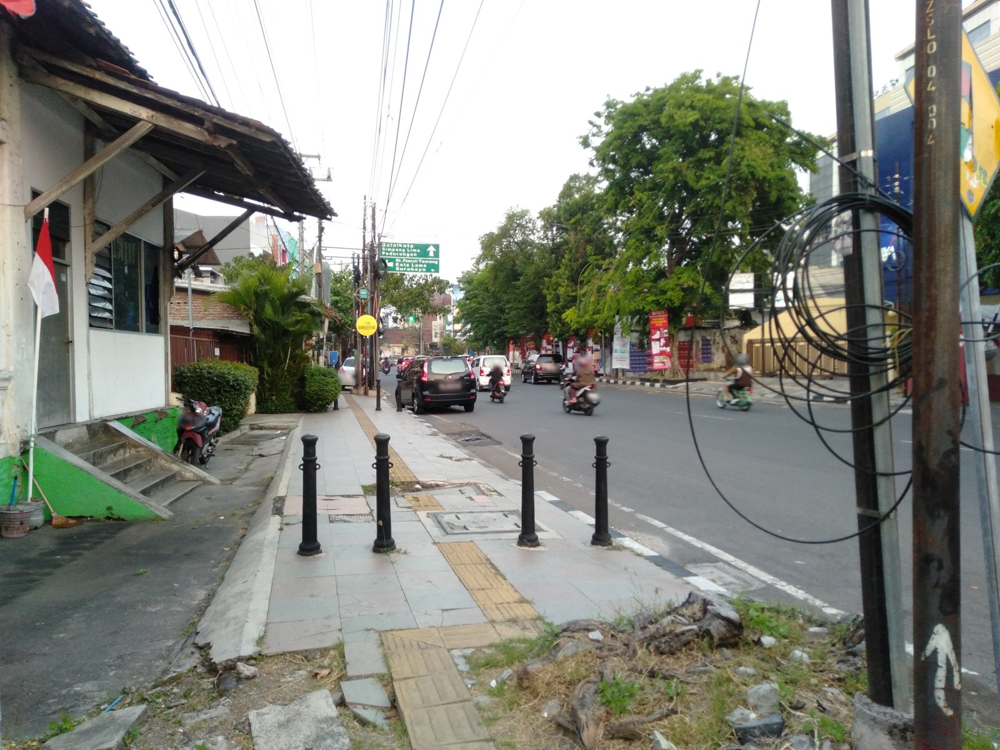
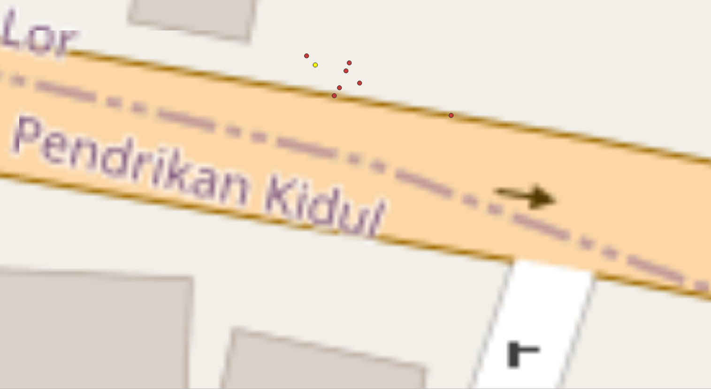
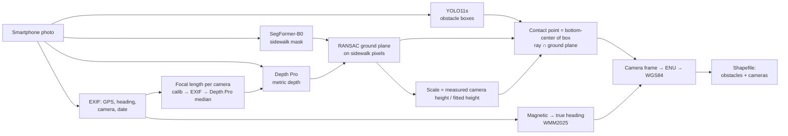
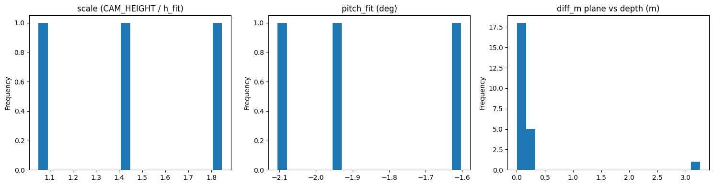
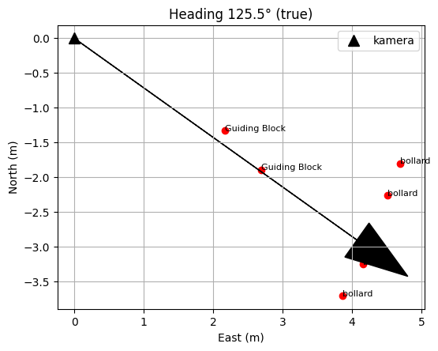
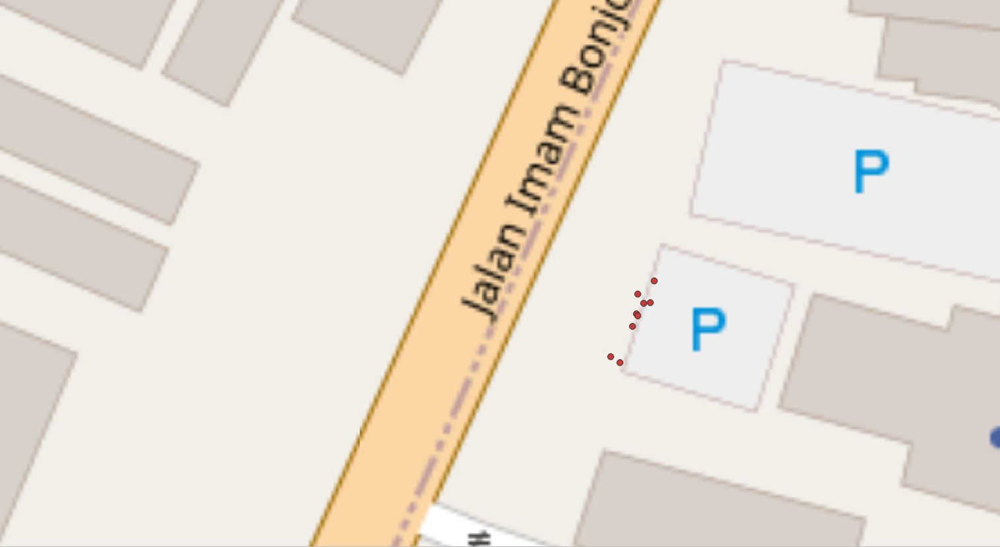
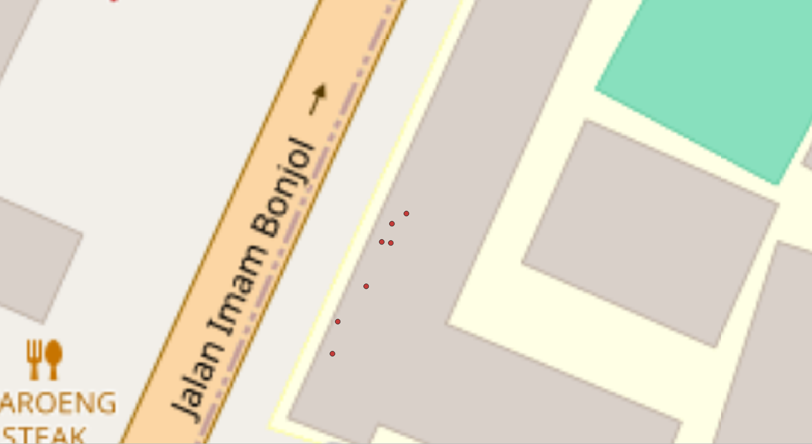

# Sidewalk Obstacle Geolocation from Smartphone Photos

Detect sidewalk obstacles (bollards, poles, guiding blocks, tree trunks, parked vehicles, …) in an ordinary smartphone photo and place each one on a map, using **only that single photo and its EXIF** (GPS + compass heading). No image sequence, multi-view reconstruction, or special hardware.

<p align="center">
  
  
</p>
<p align="center"><sub>Left: input photo (plates/faces anonymized). Right: projected obstacles in QGIS. Map data © OpenStreetMap contributors.</sub></p>

---

## Contents
- [How it works](#how-it-works)
- [Models](#models)
- [Results](#results)
- [What changed from the first version](#what-changed-from-the-first-version)
- [Repository structure](#repository-structure)
- [Getting started](#getting-started)
- [Configuration](#configuration)
- [Limitations and roadmap](#limitations-and-roadmap)
- [Privacy](#privacy)
- [References](#references)

---

## How it works



**Key ideas**

1. **Metric depth, then re-scaled.** Depth Pro gives depth in meters, but its absolute scale drifts between photos (correction factors of 1.05–1.84× in tests). A ground plane is fitted with RANSAC on sidewalk pixels; its distance to the camera is compared with the **measured** phone height, and everything is re-scaled.
2. **Orientation from the ground, not the IMU.** The plane normal gives the camera's real pitch and roll. Only the compass heading comes from EXIF.
3. **Position from geometry.** An obstacle's position is the intersection of the ray through its ground-contact pixel (bottom-center of the bounding box) with the fitted plane:

   $$P = r \cdot \frac{-h_{\text{fit}}}{n \cdot r} \cdot s, \qquad s = \frac{h_{\text{cam}}}{h_{\text{fit}}}$$

   Depth at the contact patch is computed too and kept as a consistency check (`diff_m`).
4. **True heading.** Phone compasses report magnetic north (`GPSImgDirectionRef = M`). Declination is computed offline with the World Magnetic Model (≈ 0.75° E for Semarang, Sept 2025).
5. **One focal length per camera.** Make + Model + focal (mm) + image size define a camera. Source priority: calibration → EXIF 35 mm equivalent → EXIF mm + sensor width → median Depth Pro estimate across all photos from that camera. Works for any phone brand.
6. **ENU → WGS84** with a local tangent plane on the WGS84 ellipsoid (negligible error below 100 m).

**Why the range is capped.** For a camera at height $h$ with focal $f$, ground distance is $D = hf/(v - v_\text{horizon})$, so a pixel error at the box bottom becomes

$$\left|\frac{dD}{dv}\right| = \frac{D^2}{h f}$$

At $h$ = 1.4 m and $f$ = 3018 px: 0.024 m/px at 10 m, 0.053 m/px at 15 m, 0.095 m/px at 20 m. Obstacles beyond 15 m are discarded.

---

## Models

### SegFormer-B0 — sidewalk segmentation
| | |
|---|---|
| Base | `nvidia/segformer-b0-finetuned-ade-512-512` (3.7 M params), head replaced with 2 classes |
| Data | Roboflow `sidewalk-zhrul` v2, PNG semantic masks (background / sidewalk) |
| Training | 512×512, AdamW lr 2e-5, batch 8, mixed precision, early stopping on val loss (patience 10) |
| Published checkpoint | `segformer_final.ckpt` — last epoch (20), used for all results below. Best val loss during training: **0.076** (epoch 10) |
| Test set | Not yet evaluated — run `notebooks/01_train_segformer_sidewalk.ipynb`, Section 7 |

### YOLO11s — obstacle detection (13 classes)
| | |
|---|---|
| Data | 1,980 train / 83 val images, 1024×1024 |
| Training | AdamW lr0 1e-3, imgsz 1024, batch 16, early stopping (patience 20), A100 |
| Result | **mAP50 0.627, mAP50-95 0.329** (best epoch 28) |

| Class | mAP50 | Recall | | Class | mAP50 | Recall |
|---|---:|---:|---|---|---:|---:|
| bollard | 0.798 | 0.755 | | Guiding Block | 0.394 | 0.320 |
| car | 0.735 | 0.807 | | pole | 0.423 | 0.321 |
| blockade | 0.626 | 0.484 | | tree-trunk | 0.493 | 0.472 |
| motorcycle | 0.542 | 0.614 | | bicycle | 0.331 | 0.308 |

Full per-class table in notebook 02. Guiding blocks, poles, and tree trunks are the main sidewalk obstacles but have low recall — the first target for more data.

### Depth Pro
Apple's pretrained metric depth model ([paper](https://arxiv.org/abs/2410.02073)), loaded from Hugging Face (`apple/DepthPro-hf`). Not fine-tuned.

---

## Results

Three photos taken with an OPPO A7 in Semarang, Indonesia (Jl. Pendrikan Kidul / Jl. Imam Bonjol), 5 Sept 2025.

> These results were produced with an earlier configuration (`MIN_CONF` 0.35, `MAX_DIST_M` 20 m, focal estimated per photo). The current defaults (`MIN_CONF` 0.5, `MAX_DIST_M` 15 m, one focal per camera) were derived from these results; see [Configuration](#configuration).

| Photo | Condition | Fitted height | Scale | Pitch | Obstacles |
|---|---|---:|---:|---:|---:|
| IMG_20250905_172550 | Open sky | 0.76 m | 1.845 | −1.60° | 8 |
| IMG_20250905_173043 | Under trees | 1.33 m | 1.051 | −2.10° | 9 |
| IMG_20250905_173344 | Under trees | 0.97 m | 1.441 | −1.95° | 7 |

<p align="center"></p>

- **Depth Pro's metric scale is unstable** (fitted camera height 0.76–1.33 m vs. 1.4 m measured) → re-scaling by camera height is essential.
- **Ground-plane fit is stable**: pitch −1.6° to −2.1°, consistent with a hand-held phone.
- **Internal consistency is good**: 23 of 24 obstacles have < 0.35 m between plane-based and depth-based positions. The single outlier (3.25 m) is a bollard at 18.5 m with confidence 0.47 — consistent with the $D^2$ sensitivity above.

### Open sky vs. tree canopy

<p align="center">
  
</p>
<p align="center"><sub>Open-sky photo, top view relative to the camera: guiding blocks fall on the heading line, bollards 1.5–2 m to the right — matching the photo.</sub></p>

<p align="center">
  
  
</p>
<p align="center"><sub>Photos under tree canopy: obstacles still form a clean row parallel to the street, but the whole row is shifted off the sidewalk. Map data © OpenStreetMap contributors.</sub></p>

The open-sky photo lands on the sidewalk. Under the canopy, the obstacles keep their relative layout but shift together — the signature of a **shifted camera GNSS position** (canopy attenuation/multipath), not a depth error, which would distort spacing between obstacles. The largest scale correction (1.845) was in the open-sky photo, so scale is not the cause.

> These results come from 3 photos and are validated visually. Quantitative validation against measured ground truth is on the roadmap.

---

## What changed from the first version

The first version used Street View screenshots with manually entered coordinates and MiDaS; points jumped around with errors of tens of meters.

| Problem | Fix |
|---|---|
| MiDaS outputs relative *inverse* depth; it was used as distance × 10 | Metric depth + scale from camera height |
| Depth cast to `uint8` after median normalization (overflow) | Removed |
| `rot_z(yaw)` applied in the camera frame (acts as roll) | Orientation from ground normal; heading applied in ENU |
| Missing yaw defaulted to 0 (everything faces north) | Photos without heading are skipped |
| Contact point at `center + 1.0·h` (half a box below the object) | Bottom edge of the box |
| Focal from `focal_mm / 6.17 mm`, fallback 4 mm | Per-camera focal (calibration / EXIF / Depth Pro) |

---

## Repository structure

```
├── notebooks/
│   ├── 01_train_segformer_sidewalk.ipynb   # SegFormer fine-tuning + test-set IoU
│   ├── 02_train_yolo_obstacles.ipynb       # YOLO11s training + per-class metrics + F1-optimal confidence
│   └── 03_geolocate_obstacles.ipynb        # geolocation pipeline
├── tools/
│   └── anonymize_sample_photos.ipynb       # blur plates/faces while keeping EXIF
├── sample_data/
│   ├── photos/                             # 1 anonymized sample photo (EXIF intact)
│   └── results/                            # results_all.* and cameras.* shapefiles
├── docs/images/                            # figures used in this README
├── models/README.md                        # where to download the weights
├── requirements.txt
└── LICENSE                                 # AGPL-3.0
```

---

## Getting started

Everything runs in **Google Colab** (GPU runtime).

1. **Weights** are downloaded automatically from [Hugging Face](https://huggingface.co/wahyunan/sidewalk-obstacle-geolocation) by notebook 03 (see [`models/README.md`](models/README.md)):
   - SegFormer: [`segformer_final.ckpt`](https://huggingface.co/wahyunan/sidewalk-obstacle-geolocation/blob/main/segformer_final.ckpt)
   - YOLO11s: [`yolo-obstacle-detection.pt`](https://huggingface.co/wahyunan/sidewalk-obstacle-geolocation/blob/main/yolo-obstacle-detection.pt)
2. **Open `notebooks/03_geolocate_obstacles.ipynb`** and run the install cell. It pins `transformers==4.57.6` — the SegFormer checkpoint does not load in transformers 5.x (layer names changed). **Restart the session** after installing.
3. **Set the photo folder and camera height** in the configuration cell:
   ```python
   IMAGE_FOLDER = Path("/content/drive/MyDrive/sidewalk_photos/")   # your photos, or sample_data/photos/ after cloning
   SEGFORMER_CKPT = hf_hub_download(HF_REPO, "segformer_final.ckpt")
   YOLO_WEIGHTS   = hf_hub_download(HF_REPO, "yolo-obstacle-detection.pt")
   cfg["CAM_HEIGHT_M"] = 1.4                                        # measured lens height above the sidewalk
   ```
4. Run Sections 2–4 (functions, models, per-camera focal), Section 5 to inspect one photo step by step, Section 6 to process the folder.
5. Open `results_all.shp` and `cameras.shp` in QGIS on an OpenStreetMap or satellite basemap. Use the `heading` field to rotate camera arrows.

**Taking your own photos**
- Turn on location; make sure the camera app stores direction (most do).
- Transfer the **original files** — messaging apps strip EXIF. iPhone: set *Camera → Formats → Most Compatible* (JPEG, not HEIC).
- Use 1× zoom, hold the phone at a known height, and prefer open sky.

---

## Configuration

| Parameter | Value | Basis |
|---|---|---|
| `CAM_HEIGHT_M` | 1.4 m | **Measure it.** Sets metric scale; 10 cm error ≈ 7% distance error |
| `MAG_DECLINATION_DEG` | `"auto"` | WMM2025 from GPS + date |
| `CAMERA_CALIB` | `{}` | Optional checkerboard focal per camera model (highest priority) |
| `PLANE_MIN_Z` / `PLANE_MAX_Z` | 1 / 15 m | Depth range of sidewalk pixels used for the plane fit |
| `MAX_DIST_M` | 15 m | From $\lvert dD/dv\rvert = D^2/(hf)$ |
| `MIN_CONF` | 0.5 | Temporary; replace with F1-optimal confidence from notebook 02 |
| RANSAC iterations | 300 | $N = \log(1-p)/\log(1-w^3) \approx 252$ for $p$ = 0.999, $w$ = 0.3 |
| RANSAC threshold | 0.08 m | Tile roughness + depth noise |
| Ground normal tolerance | 35° | Accessible ramps ≤ 4.8°, hand-held tilt < 20°; rejects walls |

Each parameter is explained in more detail in the notebooks.

---

## Limitations and roadmap

**Main error sources**
| Source | Effect |
|---|---|
| Phone GNSS | Shifts every obstacle in a photo together; worse under canopy |
| Compass heading | 5° error ≈ 1.3 m sideways at 15 m |
| Camera height | Linear scale error |
| Box bottom edge | Distance error grows with $D^2$ |
| Detector recall | Missed guiding blocks, poles, tree trunks |

**Roadmap**
- [ ] Field validation: tape/laser distances camera → obstacle (separates geometry error from GNSS/heading error); measured phone height
- [ ] 20–30 test photos across streets, open vs. canopy, more than one phone brand
- [ ] SegFormer test-set IoU (final vs. best-val-loss checkpoint); F1-optimal YOLO confidence
- [ ] Re-run geolocation with the current defaults and refresh the figures
- [ ] More training data for guiding blocks, poles, tree trunks; augmentation for SegFormer
- [ ] Multi-view fusion of the same obstacle across photos
- [ ] Interactive web map + upload demo

---

## Privacy

The sample photo has license plates and riders' heads pixelated (`tools/anonymize_sample_photos.ipynb`). EXIF is copied back from the original so the pipeline still runs, and the **embedded EXIF thumbnail is removed** — it would otherwise contain the un-blurred image. Other test photos are not published.

---

## References

- Bochkovskii et al. (2024). *Depth Pro: Sharp Monocular Metric Depth in Less Than a Second.* [arXiv:2410.02073](https://arxiv.org/abs/2410.02073)
- Xie et al. (2021). *SegFormer: Simple and Efficient Design for Semantic Segmentation with Transformers.* NeurIPS. [arXiv:2105.15203](https://arxiv.org/abs/2105.15203)
- Fischler & Bolles (1981). *Random Sample Consensus.* Communications of the ACM 24(6).
- NOAA NCEI / BGS. [World Magnetic Model](https://www.ncei.noaa.gov/products/world-magnetic-model) · [pyGeoMag](https://pygeomag.readthedocs.io/)
- Ultralytics. [YOLO11 training](https://docs.ultralytics.com/modes/train/) · [performance metrics](https://docs.ultralytics.com/guides/yolo-performance-metrics/)

---

## License

Code and model weights: **AGPL-3.0** (see [`LICENSE`](LICENSE)). The YOLO weights are fine-tuned with Ultralytics YOLO, and Ultralytics-trained models fall under AGPL-3.0 ([Ultralytics license](https://www.ultralytics.com/license)). Depth Pro weights are subject to Apple's license and are downloaded from Hugging Face, not redistributed here. Map tiles in figures © OpenStreetMap contributors.

## Author

**Wahyunan Andika** — [GitHub](https://github.com/wahyunanandika) · [Hugging Face](https://huggingface.co/wahyunan)
